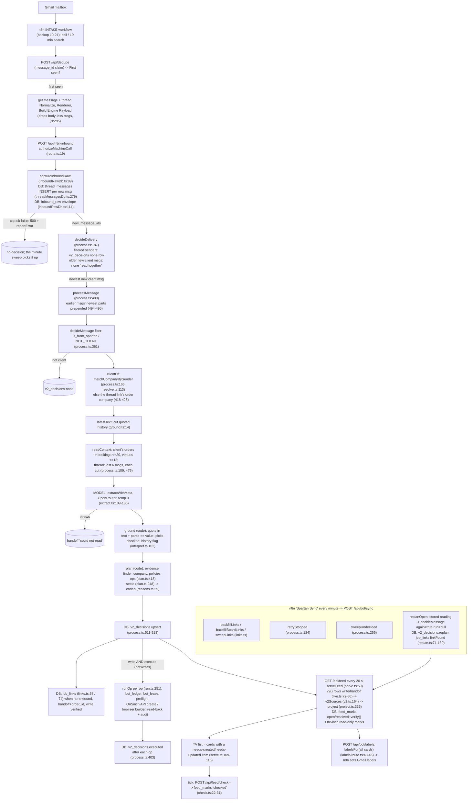

# Pipeline trace: one client email end to end through the current code

- agent: archaeologist
- brief hash: b6c84053
- generated (UTC): 2026-10-25T00:33:16Z
- code: branch v2 at 6a98170 (6a98170a2c4c181cc0db91247683dfe2b1aec7c2)
- data: `.tmp-data/gold/` (meta.json `taken_at` 2026-10-23T01:45:22.758Z)
- traced emails: WRITE `1a158ba2b8c735d6` (thread `1a15884b2b340cbe`, company 582, order R11766 / OnSinch 16830); HANDOFF `1a164788327208b7` (thread `1a164788327208b7`, company 765, later order R11824 / OnSinch 16904)

## Summary

1. **Stages.** n8n POSTs the whole thread to `/api/n8n-inbound` (n8nInbound.ts:56). Capture stores each new message in `thread_messages` and an envelope in `inbound_raw` (inboundRawDb.ts:89-130). Only the newest new client message is decided; older new ones get `none: read together` rows (process.ts:187-226). `decideMessage` runs: sender filter, client resolution, context build, **one model call** (extract.ts:114), code grounding, the code planner, the `v2_decisions` record, a `job_links` link, and a write only when writes are on (process.ts:359-461, 230, 503). The bot writes through ledger, lease, API or browser, then reads back (run.ts:251-370). `/api/bot/sync` runs every minute: link sweeps, write retries, the undecided sweep, and a re-plan with no model call (sync/route.ts:29-36). The TV is a projection of `v2_decisions`, `job_links` and `feed_marks`, refreshed every 20 s (serve.ts:59-153; LiveFeedScreen.tsx:35). Gmail labels come from the same cards (labels/route.ts:43-46).
2. **Code vs model.** The model picks the intent, the requests and their actions, the values with their quotes, an R number and shift from the bookings it is shown, a venue_id, a PO and a company name (extract.ts:45-90). Code keeps a value only if its own parser reads the same value from the quote (interpret.ts:123-142). It keeps a pick only if the client's words or the thread's link bear it out (interpret.ts:198-239). Everything after the read is code. Places where the model chooses something code already holds include the order pick (212 of 724 readings), the venue_id (65 of 724), cancel/confirm intent (code has its own regexes) and the company name; §5 lists seven.
3. **Headers and quoted text.** In-Reply-To, References and the RFC id are stored (threadMessagesDb.ts:239-244). **No file on the v2 decision path reads them** (grep over app/lib/v2, app/lib/feed, app/api/bot and app/api/n8n-inbound: 0 files). They are populated on **0 of 7,289** snapshot messages. `latestText` cuts quoted history from every message (ground.ts:14-27); it cut text from 3,334 of 3,514 client messages. Earlier messages reach the model as separate rows: last 6, at most 1,500 chars each (process.ts:476-477). Only the order finder reads full bodies, by regex for R, J and PO tokens (threadState.ts:55-57, 78).
4. **Client before opportunities: yes.** The client is resolved first (process.ts:414). The model is shown only that company's bookings, and none when there is no client (process.ts:109-115). The planner resolves the company again with one extra fallback (plan.ts:481-485). Its evidence pool spans up to 4 companies (plan.ts:220-221), but it accepts only an order of the resolved company (plan.ts:197, 202). 141 of 794 client decisions have `company_id` null.
5. **New order / not an inquiry.** "No existing order, so a new order" exists only as a `create_order` op (plan.ts:710-836) or as a lead-days handoff the TV draws as "Order needs created" (v2.ts:85-91). The snapshot has 27 such ops and 13 such handoffs. "Not an inquiry" has no decision kind or code. The nearest are `none: not a client's email` (a sender regex; 53 of 847) and `none: no change asked for` (model intent `info_only`; 427 of 847). Neither ever shows on the TV (v2.ts:109; live.ts:80).
6. **Display.** A card is listed only if it holds a needs-created or needs-updated item (serve.ts:109-115). Bot writes and needs-reply items are counted, not listed. There is one card per `thread_id` (project.ts:391-393, 476) and no dedupe across threads. A card leaves through a replan to `none` (a `resolved` mark), a tick, a verifier mark or a dismiss; green stays 24 h (project.ts:425-441). It leaves silently when its last job day passes, or when it is undated and quiet for 14 days (project.ts:417, 442). A need nobody confirms stays red and is flagged follow-up after 24 h (project.ts:474).
7. **The two traces under the current code (6a98170).** HANDOFF `1a164788327208b7` reproduces: `policy_lead_days`. The replan turns it into `none: already booked: R11824` once staff build that order, and the card goes green. WRITE `1a158ba2b8c735d6` was recorded at 6f570a3e as a verified add_shift on R11766, which staff deleted 92 minutes later (timeline row 1034629). The current code gives `none: already booked: R11766` from the same stored reading. Both requests are now `history`: every quote is in earlier messages (interpret.ts:324-330; plan.ts:537-541).

---

## 0. Method

- **Reading the code.** Every file named in `_common.md`, read at 6a98170, plus: the routes that call it (`app/api/n8n-inbound`, `bot/sync`, `bot/process`, `bot/labels`, `feed`, `feed/check`), `engine/resolve.ts` (client rules), `bot/apiCreate.ts`, `mail/threadLabels.ts`, `middleware.ts`, `paused.ts`, `n8n/nodes/build-engine-payload.js` and the n8n backup `n8n/backups/bookings-CPIRu7CpezvKjU8d.2026-10-21T21-23-20-344Z.json`. That backup shows the workflow's shape on 10-21. The live n8n workflow was not read: that would be a network call.
- **Offline replay.** The traced emails went through production's own `decideMessage` (process.ts:359), in process, with:
  - reader: the stored extraction from readings.json, so there was no model call;
  - World: built from the snapshot files (orders.json, companies.json, places.json, professions.json);
  - `run: null`, `fetch` replaced by a function that throws, and production's `tracer` (trace.ts:26) as the sink.

  The "intake" replay uses a world as of the decision instant: orders, shifts and positions created later are removed, and `modified` stamps later than that instant are reset to `created`. The "replan" replay uses the snapshot as is with `again: true`, which is what replan.ts:97-105 does. The feed simulation runs production's `serveFeed` (serve.ts:59) on those rows, with marks kept in memory. Appendix A has the recipe. Limits: objects deleted before the snapshot are missing from it; `prior` was approximated by grounding the earlier stored readings without their read context; `threadOrderId` was rebuilt from links first seen before the decision and from earlier ops. Scratch scripts lived in `.tmp-v2/arch-*` and have been deleted.
- **Choosing the emails.** From the 69 write and 207 handoff rows in decisions.json:
  - WRITE: the newest write row with a verified execution and a multi-message thread.
  - HANDOFF: the newest handoff row whose order later appeared in OnSinch. Its thread also shows the removal path.

---

## 1. Diagram



Timeline of the two traced threads (UTC, from messages.json, decisions.json, links.json, orders.json and timeline.json):

```
WRITE thread 1a15884b2b340cbe (company 582)
08:54:03 client msg 1a15884b2b340cbe  -> 08:54:56 handoff "a new booking from 2026-10-22, within 14 days of the email, is for staff to create"
09:10:42 staff create R11766 (OnSinch 16830, 2 shifts: 10-22 14:00-16:00 and 10-23 07:00-09:00 London)   [timeline 1033945-1033950]
09:15:20 our reply
09:24:03 client msg 1a158a03729adc9a  -> 09:24:50 none "no change asked for"
09:52:27 client msg 1a158ba2b8c735d6  (stored 09:52:44) -> 09:53:00 WRITE add_shift R11766 10-22 14:00-15:00 x2 (code 6f570a3e)
09:53:18 bot (user 2257) creates SlotTeam 42839 / Slot 60328 on R11766   [timeline 1034123-1034124]; executed: verified
09:53:21 job_links (thread, 16830) source "bot write"
11:25:02 a staff user deletes SlotTeam 42839   [timeline 1034629]

HANDOFF thread 1a164788327208b7 (company 765)
16:36:09 client msg 1a164788327208b7 (stored 16:36:45) -> 16:36:53 handoff "a new booking from 2026-10-31, within 14 days of the email, is for staff to create" (code c66d371b)
17:01:26 staff create R11824 (OnSinch 16904, 10-31 00:30-04:30, 3 crew + 1 of profession 36)
17:02:44 job_links (thread, 16904) source "planner find"   (the replan's linkFound, replan.ts:133)
17:03:09 our reply
```

---

## 2. Stage by stage: input, output, failure modes, logging

**S0. n8n intake (outside the repo's runtime).**
- Input: Gmail. Shape per the 10-21 backup: Poll / "Get many messages" (last 10 min) / Loop / Dedupe Claim (`/api/dedupe`) / First seen? / get message + thread / Normalize Data / MAINDATA / Conversational Renderer / Build Engine Payload / POST to Engine. The "AI Agent", "Parse Job Determinism Output", "If", "gpt-5" and "opus 4.6" nodes are **disabled**. Command: `node -e "const W=require('./n8n/backups/bookings-CPIRu7CpezvKjU8d.2026-10-21T21-23-20-344Z.json');for(const n of W.nodes)console.log(n.name,n.disabled?'DISABLED':'')"`.
- Output: `{thread_id, messages[]}`, with headers when present (build-engine-payload.js:213-253).
- Failure modes: a message with an empty body is dropped before the POST (build-engine-payload.js:295). A message not "first seen" by the dedupe claim is not posted. Drafts are refused only when labels arrive (threadMessagesDb.ts:185-195).
- Logging: n8n executions (not read).

**S1. Route and capture.**
- Input: the POST body.
- Output: `CaptureResult.new_message_ids`, the messages this delivery stored for the first time (inboundRawDb.ts:80-81, 124-125; threadMessagesDb.ts:290).
- Transforms:
  - author taken from X-Original-Sender for Google Group mail (threadMessagesDb.ts:205-211, 232);
  - `is_from_spartan` (257-260);
  - chain headers, Cc and attachment names (239-247);
  - the message's other headers (list-unsubscribe, auto-submitted, precedence, spam) are **not stored**. `envelopeOf` drops `messages` (inboundRawDb.ts:58-63), and thread_messages has no column for them (threadMessagesDb.ts:36-64).
- DB writes:
  - `thread_messages` INSERT ... ON CONFLICT DO NOTHING (279-289);
  - `fillHeaders` UPDATE on re-delivery (307-322);
  - `inbound_raw` INSERT (inboundRawDb.ts:114-121).
- Failure modes:
  - unauthorized: 401 (route.ts:19);
  - bad JSON: 400 (n8nInbound.ts:59);
  - capture `ok:false`: 500 and `reportError`, with no decision (n8nInbound.ts:70-73);
  - a partial store returns the stored ids with ok:false (threadMessagesDb.ts:294-296);
  - SPARTAN_PAUSED=1 answers 503 at the middleware (middleware.ts:48; paused.ts:11, 45-47).
- Logging: `console.error` (inboundRawDb.ts:127; threadMessagesDb.ts:295) and an emailed `reportError` (n8nInbound.ts:71, 78).

**S2. Delivery selection.**
- Input: the new ids.
- Output: one decided message per delivery.
- Behaviour: rows ordered by date_iso, first_seen_at (process.ts:190). Each filtered sender gets a `none: not a client's email` row (195-202). Only the newest client message is decided (203, 213-214). Each older new client message gets `none: read together with the later email <id>` (215-222), and its newest part is prepended to the decided message's body (494-495).
- Failure modes: a message already decided is skipped (213-214). A throw during the decision means 500 and `reportError` (n8nInbound.ts:77-79), and the message is left to S12.
- Logging: the `v2_decisions` rows.

**S3. Sender filter.**
- Input: the from address.
- Output: client or not.
- Rule: `is_from_spartan || NOT_CLIENT` = `/spartancrew\.co\.uk|no-?reply|mailer-daemon|postmaster|onsinch|sinch\.cz/i` (process.ts:161, 361).
- Data: 53 of 847 decisions are `not a client's email`. 10 messages stored since V2_FROM have no decision row; all 10 are mailer-daemon or no-reply senders stored on 10-09/10-10, before the filter's rows were recorded (comment at process.ts:193-194).
- Logging: the trace event "filter" is emitted (process.ts:363, 368), but production's sink is `noTrace` (process.ts:519; trace.ts:40).

**S4. Client resolution.**
- Input: the sender address and OnSinch companies, all of them read every email (process.ts:88).
- Output: `{id, name}`.
- Rules, in order:
  1. Exactly one company whose contact domain equals the sender's. Consumer domains and Spartan's domain give nothing (resolve.ts:79-93).
  2. Else the exact address on one company, free mail included (resolve.ts:113-122).
  3. Else, for a non-free-mail domain, the invoice domain on one contact-less company (resolve.ts:123-126).
  4. Else the company of the thread's linked order (process.ts:418-426).
- Both traced emails resolved by rule 1, to 582 and 765.
- Failure modes: an ambiguous or unknown sender gives null (no throw), and the stage swallows its own errors (process.ts:172-174).
- Logging: `company_id` and `company` columns (process.ts:514).

**S5. Context build.**
- Input: the client id, the email's sent time and the thread rows.
- Output: `ReadContext {thread, bookings, venues}` (context.ts:23).
- Contents:
  - bookings: the company's newest 1,000 orders (process.ts:91-100), filtered to a live shift from 1 day before to 90 days after the email, at most 20, nearest first, no status filter (context.ts:29-50);
  - venues: the 12 most used (context.ts:54-57);
  - thread: the last 6 earlier messages, ours included, each `latestText` (process.ts:475-477).
- Failure modes: with no client the bookings and venues are empty (process.ts:110). A context error is swallowed and the read continues without context (process.ts:429).
- Observed: WRITE intake read context `bookings=1 [R11766] venues=1`; HANDOFF `bookings=1 [R11350] venues=3`.

**S6. Model read (the only model call).**
- Input: sent time, from, subject, the newest text (at most 6,000 chars) and the context text (extract.ts:92-94).
- Call: `openai/gpt-6.1-sol` unless `SPARTAN_INTERPRET_MODEL` is set (extract.ts:102); OpenRouter, temperature 0, json_object, 60 s timeout (extract.ts:114-122).
- Output: `Extraction` (extract.ts:34-43), parsed without schema validation (extract.ts:132).
- Failure modes: no key, non-2xx, no JSON or a JSON parse error all throw, and the email becomes a handoff "the system could not read this email (...)" (process.ts:434-440). Wrong-typed fields become grounding problems (interpret.ts:125).
- Logging: `interpretation.meta` = model, prompt_id (a hash of the system prompt), tokens, cost, ms (extract.ts:104, 133; process.ts:441-444, 460).

**S7. Grounding (code).**
- Input: the extraction, `${subject}\n${newest}`, the sent time, and `{subject, prior, read, linkedOrderId}` (process.ts:447).
- Output: `Interpretation {intent, po, requests[], problems, notes, order_id, company_name}` (interpret.ts:65).
- Rules:
  - A value stands only if its quote is in the quotable text and code parses the same value from it (interpret.ts:123-142). New shifts may quote the whole thread; changes only the client's newest words (155).
  - A pick stands only if it is among the shown bookings and borne out (198-239).
  - Venue: a substring check (177).
  - Trade: quote presence only (179).
  - `history` is set when no value the request sets is quoted from the client's own words (324-330).
  - Missing days and venues are filled from the subject or earlier requests (277-285).
  - A confirmation re-uses earlier complete requests as history (370-376).
  - A PO stands only after a label (354-364; ground.ts:162-174).
- Failure modes: problems block the email in S8 (plan.ts:447, 471).
- Logging: grounded is stored in `interpretation.grounded` (process.ts:460).

**S8. Planning (code).**
- Input: the interpretation, the World, `threadOrderId`, and the opts (thread, raw, leadDays, now, again).
- Output: `Decision = write{ops,why} | handoff{reasons, reply?, order_id?} | none{reason, found?}` (plan.ts:41-50).
- The checks in order:
  1. evidence pool (215-237);
  2. history split (445-447);
  3. idle stand-downs (451-466);
  4. problems become a reply or a handoff (470-471);
  5. quote, unclear and info_only (474-476);
  6. company (481-485);
  7. a stranger's cancellation or info is none (488);
  8. a new client (496-500);
  9. past or over days (514-523);
  10. history requests (528-541);
  11. default times (545-553; assume.ts:60-73);
  12. changes (557-653);
  13. new shifts on a named order (658-704);
  14. a linked but unreadable order (705-709);
  15. new-order path: already booked (710-747), partly booked (753-766), lead days (773-775), venue, new place or No Location (777-820), create_order (825-836);
  16. PO (837-849).

  `settle` (248-280) may turn a handoff into `none: already booked` or attach an `order_id`.
- Failure modes: any throw is a handoff "could not plan" (process.ts:458), and any throw in `understand` is "could not decide" (process.ts:374-378).
- Logging: the reason text, plus `code` from reasons.ts:19-67, which is stamped since 10-24, so snapshot rows carry no `code`.

**S9. Record.**
- `v2_decisions` upsert, keyed on message_id (process.ts:511-518; table at 53-67). `code_version` is the commit sha, "deployed-unknown" or "local" (process.ts:78).

**S10. Link.**
- `none` with `found` gives `linkFound(..., "planner find")` (process.ts:389).
- A handoff with `order_id` gives `linkFound(..., "finder")` (391).
- A verified write gives `recordLink(..., "bot write")` (406, 507-510).
- `linkFound` never displaces a live link (links.ts:74-82). `recordLink` reads the order from OnSinch, read only (links.ts:57-65).
- `threadOrderId` is the newest link, else an order id in the thread's decisions' executed or ops (threadOrder.ts:16-31).

**S11. Write (OnSinch).**
- Gate: `botWrites()` is `SPARTAN_WRITES=live` and the Settings flag `bot_writes_enabled` (process.ts:33-36). Intake runs ops only then (process.ts:230, 503). In bench mode only company 515 can be written (run.ts:207-210).
- Per op, in `runOp` (run.ts:251-370):
  - ledger seen: `seen` (253);
  - lease 240 s: `busy` (255);
  - intent row (260);
  - read before (262-263);
  - preflight (207-219);
  - `create_order` goes through the API with `request_approval: true` (apiCreate.ts:92), after `createCompany` / `createPlace` for `new:` ids (apiCreate.ts:106-125); extra positions go through the browser builder (run.ts:265-299);
  - ops already true send nothing (301-304);
  - otherwise a browser builder edit (305-361);
  - read-back `mismatches` (85-122), plus an audit-row check of extra fields (184-205, 221-235).
- Statuses: verified, mismatch, blocked, unknown, busy, seen.
- Failure modes: an exception before the browser is `blocked`; after it, `unknown` (364).
- Logging: `bot_ledger`, and `v2_decisions.executed` after every op (process.ts:397-407).
- Snapshot: write rows by executed status: 29 all verified, 20 blocked, 3 mismatch, 17 not executed (of 69).

**S12. Minute retries and the undecided sweep.**
- `retryStopped`: a `busy` or transient `blocked` write, under 6 h old, from the same code_version, tried at most 2 times, never for a past day (process.ts:118-157).
- `sweepUndecided`: client messages stored more than 10 min and less than 24 h ago, sent within 7 days, with no decision row. They are first claimed as a handoff card, then decided as intake would (process.ts:233-304). Limit: 2 threads a minute (282).

**S13. Replan.**
- Scope: every open card row (rowsOnCard) with a stored extraction, not an executed write, sent after FEED_FROM, last day not over (replan.ts:61-66, 84).
- Limits: 20 a minute, oldest-replanned first, 90 s budget, OnSinch answers cached 5 min (replan.ts:32, 75, 85, 90).
- Runs `decideMessage` with the stored reading, `run: null`, `again: true` (replan.ts:97-115).
- Writes `v2_decisions.replan` and `replanned_at` (128-131) and calls `linkFound` (133). It never writes to OnSinch.

**S14. Link sweeps.**
- `sweepLinks` follows each link's J, then order id, R number or rebuild. It sets `relinked` or `held` (links.ts:145-202).
- A held link older than 30 min becomes an "Order not found in OnSinch" card (links.ts:25; live.ts:90-100; serve.ts:121-127).

**S15. TV projection (admission).**
- `v2()` selects rows of kind write or handoff, not `local`, created since V2_FROM, with a link only when the thread has exactly one live order (live.ts:72-86).
- Per thread: a lead row plus the older needs that no later email answered (v2.ts:164-189).
- Kind (v2.ts:87-91):
  - verified write: created-check or updated-check;
  - unexecuted or failed write: needs-created or needs-updated;
  - handoff with `reply` or every reason a reply reason: needs-reply;
  - other handoffs: needs-created when the email asks for a new booking and no order, else needs-updated.
- The item key uses the **first** decision's kind and order plus the message_id (v2.ts:105, 110).
- `project` (project.ts:336-533) adds green from marks, the dwell, follow-up and quiet flags. The list is `isFailure` cards (serve.ts:109-115).
- DB writes: `feed_marks` `open` and `resolved`, insert-once (serve.ts:76-83; marksDb.ts:62-69).

**S16. Verifier, tick, removal.** See section 9.
- Verifier: OnSinch reads only (verify.ts:38-41), once a minute across screens (verify.ts:31; marksDb.ts:84-94). It writes `order-found`, `matched`, `staff-edit` and `stamps` marks (verify.ts:313, 319, 408, 416).
- Tick: `checked` (check.ts:15-31).

**S17. Labels.**
- `labelsFor` over every card, including bot writes not on the list: green gives no order label (threadLabels.ts:48-52; labels/route.ts:43-46).
- At most 150 threads per run (labels/route.ts:15), remembered in `thread_labels`. The labels themselves are applied by n8n.

---

## 3. The WRITE email traced: `1a158ba2b8c735d6`

Recorded (decisions.json, code 6f570a3e, created 09:53:00.663Z, 16 s after it was stored):

```
write: ops [add_shift order 16830 location 17582 2026-10-22 14:00-15:00 positions [2 x profession 1]], source 1a158ba2b8c735d6#50
why: "R11766: add a shift on 2026-10-22 14:00-15:00, 2 crew"
     "assumed: 2026-10-23, no end time written: 09:00, as 9 of the client's last 10 shifts were 2h"
executed: [verified]
```

**Current code (6a98170), intake replay as of 09:53:00Z.** Trace events from production's tracer:

| stage | file:line | input -> output (this email) |
|---|---|---|
| filter | process.ts:361-368 | not ours; sender passes NOT_CLIENT, so client:true |
| client | process.ts:414; resolve.ts:79-93 | domain rule gives company 582; `threadOrderId` null (no link before 09:53:21, no earlier ops) |
| newest text | ground.ts:14-27 | body 8,490 chars cut to 1,077 (quoted history removed); subject is a reply |
| context | process.ts:109-115, 475-477; context.ts:29-70 | 3 earlier messages (thread rows before 09:52:27); bookings `[R11766]`; venues 1 |
| model (stored) | extract.ts:34-43 | intent booking; 2 requests, both `new_shift`, `order: "R11766"`: (10-22, 14:00, 15:00, crew 2) and (10-23, 07:00, no end, crew 2) |
| ground | interpret.ts:102-380 | 0 problems. Pick R11766 accepted (order_id 16830). **Both requests `history: true`**: each value's quote is in an earlier message and none is in the newest part (checked per field: `quoteIn(newest)` false and `quoteIn(earlier)` true for every date/start/end/crew quote) |
| plan | plan.ts:445-446, 528-541 | non-history reqs = 0, history = 2. Both are new shifts dated on or after today and are held by R11766 (`evidenceMatch`: day plus start time, evidence.ts:34-55). Result `none: already booked: R11766`, found [16830] |
| code | reasons.ts:40 | `none_already_booked` |
| link | process.ts:389 | `linkFound(16830, "planner find")` |
| run | process.ts:392 | not reached (kind none) |

The replan replay against the 10-23 snapshot (threadOrderId 16830) gives the same: `none: already booked: R11766`.

**What the recorded write did in OnSinch.** Timeline row 1034123/1034124, 09:53:18Z: the bot (2257) created SlotTeam 42839 and Slot 60328 on order 16830. Later rows by staff users: description and contact changes on 42839 (rows 1034547, 1034590, 1034591), then `common_delete` of SlotTeam 42839 at 11:25:02Z (row 1034629; the same second logs `common_delete Job 16894`, row 1034628). In the 10-23 snapshot order 16830 holds only staff's two shifts (teams 42835 and 42836).

**Display under the current code** (production `serveFeed` on this thread's write and handoff rows, marks kept in memory):

| instant (UTC) | rows (replan) | card | on TV list | label |
|---|---|---|---|---|
| 10-20 08:56 | handoff | red, `needs-created`, open; mark `open` stored | yes | Order Needs Created |
| 10-20 09:12 | handoff, replan `none_already_booked` | green (`resolved`), lane done | yes (done lane, 24 h) | none |
| 10-20 09:54 | + write (executed verified) | blue, `updated-check:…:16830:1a158ba2b8c735d6`, R11766 / J16894 | **no** (serve.ts:109) | Order Updated |
| 10-22 10:00 | same, nobody ticked | `follow_up: true` | no | Order Updated |
| 10-24 10:00 | same | no card (last job day 10-23 has passed, project.ts:417) | no | none |

The 09:12 row is the current code's answer and not a record of 10-20. links.json holds this thread's first link at 09:53:21 with source "bot write". `linkFound` would have kept its own source on that same (thread, order) pair, so no "planner find" link existed before the write (links.ts:57-65, 74-82).

---

## 4. The HANDOFF email traced: `1a164788327208b7`

Recorded (code c66d371b, created 16:36:53.877Z, 8 s after it was stored): `handoff: "a new booking from 2026-10-31, within 14 days of the email, is for staff to create"`.

**Current code, intake replay as of 16:36:53Z.** It reproduces the recorded decision exactly.

| stage | file:line | this email |
|---|---|---|
| filter | process.ts:361 | client |
| client | resolve.ts:79-93 | company 765 by domain; threadOrderId null |
| newest text | ground.ts:14-27 | 817 chars cut to 795; first message of the thread (subject not a reply) |
| context | context.ts:29-70 | bookings `[R11350]`, venues 3, no earlier messages |
| model (stored) | extract.ts | intent `quote_request`; 1 request `new_shift`, order null: date 2026-10-31, start 00:30, duration 240, crew 4, venue (words), trade |
| ground | interpret.ts:147-168 | 0 problems; end = start + duration = 04:30 (interpret.ts:164-165); history false (every quote is in the newest part) |
| plan | plan.ts:474 (skipped, has requests), 481, 545-546, 662 | company 765; the new shift has start and end; no pick, so `findOrder(..., explicit=true)` names nothing (plan.ts:190-208) |
| plan | plan.ts:710-740 | the venue words match no OnSinch place by name, head or key (0/0/0), so `at = null` (plan.ts:719-721). No client order has a live shift starting 2026-10-31 00:30 as of 16:36, so `fresh` |
| plan | plan.ts:317-330, 68-71 | positions: 4 total, `chiefsFor(4)` = 1, so 1 chief (profession 36) + 3 crew |
| plan | plan.ts:773-775 | earliest day 10-31 is 9 days after 10-22, within 14, so a handoff |
| settle | plan.ts:269-279 | `coveredBy` finds nothing on 10-31 as of 16:36; no ref; unchanged |
| code / link / run | reasons.ts:23; process.ts:391-392 | `policy_lead_days`; no order_id, so no link; not a write |

**Replan against the snapshot** (`again: true`, threadOrderId 16904). Staff's R11824 (created 17:01:26Z by a staff user, not 2257) has a live shift starting at 00:30 on 10-31. `bookedAt` finds it with a staff hand after the email, so `{synth: []}` (plan.ts:385). The result is `none: already booked: R11824`, found [16904] (plan.ts:743-746), and the link `planner find` (process.ts:389; replan.ts:124-133). This matches links.json: (thread, 16904), source "planner find", first_seen 17:02:44Z, 78 s after the order was created.

**Display under the current code:**

| instant (UTC) | card | on TV list | label |
|---|---|---|---|
| 10-22 16:37:30 | red `needs-created:…:0:1a164788327208b7`, dates 2026-10-31; mark `open` | yes | Order Needs Created |
| 10-22 17:02:44 (replan none) | same item, green `resolved` ("Already booked in OnSinch: R11824", v2.ts:133, 159), lane done | yes (done lane) | none |
| 10-22 17:03:44 | green; R11824 / J16968 from the link (v2.ts:147-148) | yes (done lane) | none |
| 10-23 18:10 | no card (dwell 24 h passed, project.ts:441) | no | none |
| counter-case: never replanned, nobody ticks, 10-25 17:00 | red `needs-created`, `follow_up: true` (24 h, project.ts:474) | yes | Order Needs Created |

The counter-case run read links.json as is, so its card shows R11824/J16968.

---

## 5. Choices made by code, choices made by the model

The model call happens once per decided email (extract.ts:114; no other model call in app/lib/v2, app/lib/feed or the intake files: `grep -rn "openrouter\|chat/completions" app/lib/v2 app/lib/feed` gives only extract.ts:114). The replan re-uses the stored reading (replan.ts:99).

**Model chooses** (extract.ts:45-90). Code then:

| # | choice | what code does with it | file:line |
|---|---|---|---|
| M1 | `intent` (booking / change / cancellation / quote_request / info_only / unclear) | info_only + no PO: `none` (no card). unclear: reply. quote with no requests: reply. A stranger's cancellation or info: `none`. A new client only for booking or quote. Card new-vs-update and settle use it | plan.ts:470-476, 488, 499; v2.ts:86; plan.ts:270 |
| M2 | the request list and each `action` | drives every op kind; `"2x2hr at HH:MM"` on change_crew is re-made into a new call by code | interpret.ts:294-302, 303-317 |
| M3 | values + quotes (date, start, end, duration, crew, crew_add, crew_remove, crew_chief, target) | kept only if the quote is in the text and code's parser gives the same value | interpret.ts:123-142, 147-194 |
| M3v | venue, trade | venue: the quote must contain the value's letters; trade: the quote must be in the text | interpret.ts:177, 179 |
| M4 | `order` and `shift_id` pick from the shown bookings | kept only if the booking was shown, the day agrees, and the client's words or the link bear it out | interpret.ts:198-239 |
| M5 | `venue_id` pick from the shown venues | kept if it is a shown venue and its quote is in the text | interpret.ts:269-273 |
| M6 | `po` | kept only after a PO label in the newest message | interpret.ts:354-364; ground.ts:162-174 |
| M7 | `company` name | used to **create a new OnSinch company** when the sender resolves to none and the name shares no word with an existing company | interpret.ts:379; plan.ts:496-500, 834; apiCreate.ts:106-112 |
| M8 | whole-message `order` | the PO's order | interpret.ts:378; plan.ts:841 |
| M9 | which message a quote comes from | sets `history`, which decides whether a request is new work or only checked | interpret.ts:324-330; plan.ts:445-446, 528-541 |

**Code chooses** everything else, including:
- which mail is processed (process.ts:161, 192, 203);
- the client (process.ts:166-175, 418-426; plan.ts:481-485; resolve.ts:79-127);
- the candidate set shown to the model (context.ts:29-57);
- the order found without a pick (plan.ts:190-209; threadState.ts:63-130);
- which shift a change targets (plan.ts:90-119);
- the crew-chief count (plan.ts:68-80);
- assumed times (assume.ts:60-73);
- the venue, a new place or No Location (plan.ts:138-176, 777-820);
- lead-day and past-day policies (plan.ts:514-523, 773-775);
- already-booked checks (plan.ts:379-396, 710-747);
- reply vs handoff (plan.ts:471);
- the reason code (reasons.ts:19-67);
- write gating and verification (process.ts:33-36; run.ts:85-145, 207-235);
- TV kind, admission, ordering and removal (v2.ts:68-93; serve.ts:109-115; order.ts:55-63; project.ts:409-442).

**Where the model chooses something code already holds** (facts only):
1. **Order and shift pick (M4, M8).** Code builds the bookings list the model chooses from (context.ts:29-50, 61-70). It also runs its own finder (link > R/J number in the whole thread > PO/project reference > day + one more fact; threadState.ts:63-130) whenever the model picks nothing (plan.ts:562-563, 662). The model picked an R number in 212 of 724 stored readings (count over readings.json).
2. **Venue pick (M5).** Code holds the venues list (context.ts:54-57) and its own name matcher (plan.ts:138-176). The model picked a venue_id in 65 of 724 readings.
3. **Date, time and count values (M3).** A value is accepted only when code's parser yields it from the quote (interpret.ts:127-129), so every accepted value is one code could read. The model's part is choosing *which words* and, when the words hold several values (a range such as a start and an end), which value goes in which field (interpret.ts:129).
4. **Cancel and confirm (M1).** `CANCELS` and `CONFIRM` are code regexes over the same words (interpret.ts:78-90). A cancel_shift is refused without CANCELS words (interpret.ts:313).
5. **Increase vs total (M3).** Code demands add/fewer words for crew_add or crew_remove (interpret.ts:171, 173).
6. **Company (M7).** Code resolves the sender against OnSinch contacts (resolve.ts:113-127). The model's name is used when that returns nothing.
7. **Not-an-inquiry (M1 `info_only`).** The only code rule is the sender regex (process.ts:161). The auto-reply, list and spam headers that n8n sends are discarded at capture (S1). In the snapshot, readings by intent: info_only 445, booking 107, change 77, quote_request 63, cancellation 18, unclear 14 (of 724).

---

## 6. In-Reply-To, References and quoted text

- **Stored:** `rfc_message_id`, `in_reply_to` and `reference_ids` columns (threadMessagesDb.ts:54-59), filled from the payload (239-244) or by a later re-delivery (307-322). n8n sends them per its node (build-engine-payload.js:218-228).
- **Read:** only `threadIdForMessageIds` (threadMessagesDb.ts:377-405), called only by `/api/mail-inbound` (route.ts:70). That route is shut under SPARTAN_ENGINE=v2 (paused.ts:19, 45-47; middleware.ts:48). `grep -rlE "in_reply_to|reference_ids|rfc_message_id|cc_addresses|attachment_names" app/lib/v2 app/lib/feed app/api/bot app/api/n8n-inbound` returns 0 files. Thread identity in v2 is n8n's Gmail `thread_id` (threadMessagesDb.ts:217-219).
- **Data:** 0 of 7,289 messages in the snapshot carry `in_reply_to`, `reference_ids`, `rfc_message_id`, `cc_addresses` or `attachment_names`. Command: `node -e "const m=require('./.tmp-data/gold/messages.json');const h=v=>Array.isArray(v)?v.length>0:v!=null&&v!=='';console.log(m.length,m.filter(x=>h(x.in_reply_to)||h(x.reference_ids)||h(x.rfc_message_id)).length)"`.
- **Quoted text:** `latestText` stops at the first line that is any of: a `>` line; `On … wrote:`; `-- Original/Forwarded Message`; a `From:` after content; 8+ underscores (ground.ts:14-27). It is applied to:
  - the decided message (process.ts:427);
  - each earlier thread line (477);
  - each earlier same-delivery message (494).

  It cut text from 3,334 of 3,514 client messages in the snapshot. The model sees earlier messages only as separate rows (last 6, ≤1,500 chars each; process.ts:477; context.ts:63) and may quote them (extract.ts:76; interpret.ts:104). Full bodies, quoted text included, are read only by the finder's regexes (threadState.ts:55-57, 78-97) through `threadMessages` (process.ts:480-484).

---

## 7. Is the client resolved before opportunities, and are candidates scoped to it?

- **Order of operations:** `clientOf` runs first (process.ts:414-426). The reader's candidate bookings come from `world.companyOrders(client.id)` only (process.ts:109-115). If there is no client, the model is shown no bookings and no venues (process.ts:110), and any R number it names is dropped (interpret.ts:239).
- **Planner:** it resolves the company again: sender rule, linked order's company, then the company of the order the evidence finder names (plan.ts:481-485). The evidence pool holds the orders of up to 4 companies: the sender's, the linked order's, and every company any non-Spartan thread address (From or To) could be (plan.ts:220-225; threadState.ts:146-159).
- **Acceptance:**
  - a found order must belong to `companyId` (plan.ts:202);
  - an R number is looked up across OnSinch and refused if it belongs to another client (plan.ts:194-197);
  - a link is used only if it is among `companyOrders(companyId)` (plan.ts:204-207);
  - already-booked checks for a new order use `clientOrders` only (plan.ts:716-728).
- **Two resolutions:** `v2_decisions.company_id` records the first resolution (process.ts:514), not the planner's. They can differ only by the planner's evidence fallback (plan.ts:485).
- **Data:** 141 of the 794 decisions that are not "not a client's email" have `company_id` null; 12 handoffs carry `no single client company` (code `client_unknown`).

---

## 8. Can it say "no existing order, so a new order", or "not an inquiry"?

- **New order:**
  - Path: no order named or found (plan.ts:662, 190-208), no link (plan.ts:705-709), and no client order with a live shift at that day and start (plan.ts:716-740). Then a `create_order` op (plan.ts:834), or a new company plus order (plan.ts:496-500).
  - Gates: lead days give a handoff (plan.ts:773-775), and the TV draws that handoff as "Order needs created" (v2.ts:85-91).
  - There is no decision kind for "no existing order". It shows as an op kind or as the card kind.
  - Snapshot: 27 `create_order` ops among 69 write rows; 13 handoffs coded `policy_lead_days`.
  - Created orders go to OnSinch "Orders To Confirm" (apiCreate.ts:1-8, 92).
- **Not an inquiry:**
  - Decision kinds are write, handoff and none (plan.ts:41-50). No reason code names "not an inquiry" (reasons.ts:19-44).
  - Outputs that say there is no request: `none: not a client's email` (sender regex; 53 of 847), `none: no change asked for` (model intent info_only with no PO, plan.ts:476; 427 of 847), and `none: <sender> is not a client in OnSinch, so nothing of theirs is booked` (plan.ts:488).
  - Display: a `none` decision yields no item (v2.ts:109). The TV reads only write and handoff rows (live.ts:80). So these emails never appear, flagged or otherwise.
  - Snapshot by code (reasons recomputed with today's table): none_nothing_to_do 427, none_not_client 53, none_read_together 49, none_already_booked 24, none_already_as_asked 5, none other 13.

---

## 9. Reaching the TV, leaving it, dedupe, and the item nobody confirms

**Admission.** A v2_decisions row of kind write or handoff since V2_FROM, not `local` (live.ts:76-80). Its card kind comes from v2.ts:87-91. The card is listed only if one of its items is needs-created or needs-updated (serve.ts:109-115). Held-link cards (serve.ts:121-127) and the jobs board's carried tiles (serve.ts:101) are added. A verified bot write and a needs-reply are counted (`done_by_system`, `needs_reply`) but not listed (serve.ts:116, 149). A write planned but not executed is listed as a need with "Not written, do it by hand" (cardNote.ts:139-143).

**Per-thread dedupe.**
- One source per thread (v2.ts:164-173) and one card per thread (project.ts:391-393, 476).
- Several needs on a thread are items on that one card (v2.ts:184-189; project.ts:413-416). Each email's need is its own item, since `message_id` is in the key (v2.ts:110).
- A later decision on the thread answers a need only if it is about one of its days or the order it names (v2.ts:199-210, 225-242).
- No dedupe across threads: two threads about one order are two cards. `jobKey` only shares activity times (project.ts:401-406).
- Follow-up replies attach to the existing card (project.ts:513-529).

**Removal** (each with the mark it writes):

| event | mark | file:line |
|---|---|---|
| replan answers `none` (staff booked it, already as asked) | `resolved` (insert-once), green | replan.ts:128; v2.ts:109; project.ts:425-431 |
| tick on the TV | `checked`, green | check.ts:15-31; feed/check/route.ts:11-16 |
| verifier finds the order for a needs-created | `order-found`, green | verify.ts:297-316 |
| verifier finds a staff edit after the item | `staff-edit`, green | verify.ts:402-412 |
| green for more than 24 h | (none) | project.ts:63, 441 |
| last job day has passed | (none), silent | project.ts:417 |
| undated, no client email for 14 days | (none); counted `older` | project.ts:69, 442 |
| needs-reply after our sent email | (none) | project.ts:439 |
| item older than FEED_FROM | (none) | project.ts:75, 435 |
| thread dismissed | `dismissed` | project.ts:347, 409 |
| link held more than 30 min | becomes an "Order not found in OnSinch" card | links.ts:193; live.ts:90-100; serve.ts:121-127 |

**Nobody confirms.**
- A need has no timer of its own. It stays red until one of the events above happens.
- After 24 h with no activity it carries `follow_up` (order.ts:26; project.ts:474). After 7 days it is `quiet` and sorted below fresh cards (order.ts:18, 55-63; project.ts:497).
- The replan keeps re-reading it each minute while its last day is not over, at most 20 cards a minute (replan.ts:61-66, 90).
- A bot write's `created-check` or `updated-check` is never listed. Its Gmail label "Order Created" or "Order Updated" stays until a tick or a staff-edit mark turns the card green, or its day passes (threadLabels.ts:48-52).
- §3 and §4 show both: the write thread's updated-check never listed, with follow-up from 10-22 and gone after 10-23; the handoff counter-case red with follow-up on 10-25.

---

## 10. Counts over the snapshot, with denominators

All from `.tmp-data/gold/`. The commands use only these files.

| count | value | how |
|---|---|---|
| decisions by kind | none 571, handoff 207, write 69 (of 847) | `node -e "const d=require('./.tmp-data/gold/decisions.json');const k={};for(const x of d)k[x.kind]=(k[x.kind]\|\|0)+1;console.log(k)"` |
| `none: no change asked for` | 427 of 847 | reason text starts with it |
| messages with any chain header stored | 0 of 7,289 | §6 command |
| client messages whose quoted tail latestText removes | 3,334 of 3,514 | `latestText(body).length < body.trim().length` |
| stored to decided latency | median 5 s, p90 11 s (n = 847) | `decision.created_at - message.first_seen_at` |
| client messages stored since V2_FROM with no decision | 10 of 847, all filtered senders, all 10-09/10-10 | messages.json minus decisions.json |
| readings with a model R-number pick | 212 of 724 | `request.order` or `extraction.order` set |
| readings with a model venue_id pick | 65 of 724 | `request.venue_id` set |
| handoffs flagged `reply: true` | 34 of 207 | `decision.reply` |
| company_id null | 141 of 794 (excluding not-a-client rows) | decisions.json |
| write ops by kind | create_order 27, set_position_times 23, cancel_position 20, set_po 10, add_shift 10, set_position_size 7, add_position 2 | decisions.json `decision.ops[].op.kind` |
| write rows by execution | all verified 29, blocked 20, mismatch 3, not executed 17 (of 69) | decisions.json `executed[].status` |

Decision rows in the snapshot carry no `code` field, so the codes above were recomputed from the reason text with reasons.ts:56.

---

## Appendix A: reproduction recipe (offline, $0)

The replay drives production's `decideMessage` with a file-backed World and the stored reading. Run it with `node_modules/.bin/tsx <file>.mts` from the repo root, with `DATABASE_URL` and the API keys unset.

```ts
import fs from "node:fs";
(globalThis as any).fetch = async () => { throw new Error("network refused"); };
import { decideMessage, type Recorded } from "../app/lib/v2/process";
import { tracer, type TraceEvent } from "../app/lib/v2/trace";
import { latestText } from "../app/lib/v2/interpret/ground";
import { normName } from "../app/lib/engine/resolve";
const G = ".tmp-data/gold/", J = (f: string) => JSON.parse(fs.readFileSync(G + f, "utf8"));
const msgs = J("messages.json"), dec = J("decisions.json"), reads = J("readings.json"), orders = J("orders.json");
const companies = J("companies.json"), places = J("places.json"), profs = J("professions.json");
// asOf(at): drop orders/SlotTeams/Slots created after `at`; reset modified/modifier later than `at` to created/creator.
const world = (os: any[]) => ({
  companies: async () => companies,
  placesNamed: async (n: string) => places.filter((p: any) => normName(p.name ?? "") === normName(n)).map((p: any) => ({ id: +p.id, name: String(p.name) })),
  allPlaces: async () => places.map((p: any) => ({ id: +p.id, name: String(p.name ?? ""), address: String(p.address ?? "").trim() || undefined })),
  companyOrders: async (id: number) => os.filter((o) => +o.company_id === +id).sort((a, b) => b.id - a.id).slice(0, 1000),
  orderByNumber: async (n: string) => os.find((o) => String(o.number) === String(n)) ?? null,
  orderById: async (id: number) => os.find((o) => +o.id === +id) ?? null,
  professions: async () => profs.filter((p: any) => !p.deleted).map((p: any) => ({ id: String(p.id), name: String(p.name ?? "").trim() })),
});
async function replay(mid: string, again: boolean, os: any[], now: number, threadOrderId: number | null) {
  const m0 = msgs.find((x: any) => x.message_id === mid), x = reads.find((r: any) => r.message_id === mid).extraction;
  const thread = msgs.filter((y: any) => y.thread_id === m0.thread_id).sort((a: any, b: any) => a.date_iso.localeCompare(b.date_iso));
  const ev: TraceEvent[] = []; let rec: Recorded | null = null;
  await decideMessage(m0, {
    extract: async () => ({ x, meta: { model: "stored", prompt_id: "stored", input_tokens: 0, output_tokens: 0, cost_usd: 0, ms: 0 } }),
    world: world(os), run: null, leadDays: async () => 14, now: () => now, again,
    thread: async () => thread.filter((y: any) => y.date_iso < m0.date_iso).slice(-6).map((y: any) => ({ who: y.is_from_spartan ? "spartan" : "client", at: y.date_iso, text: latestText(String(y.body ?? "")) })),
    prior: async () => [],  // the trace above grounded earlier stored readings here; [] gives the same results for both emails' plan kind
    threadMessages: async () => thread.map((y: any) => ({ message_id: y.message_id, from: String(y.from_address).toLowerCase(), to: [].concat(y.to_addresses ?? []), at: Date.parse(y.date_iso), subject: y.subject ?? "", body: y.body ?? "", ours: !!y.is_from_spartan })),
    threadOrderId: async () => threadOrderId, link: async () => {}, record: async (r) => { rec = r; },
    trace: tracer((e) => ev.push(e), { trace_id: mid, run_mode: "test" }),
  });
  return { rec, ev };
}
// WRITE intake: replay("1a158ba2b8c735d6", false, asOf(Date.parse("2026-10-20T09:53:00.663Z")), that instant, null) -> none "already booked: R11766"
// HANDOFF intake: replay("1a164788327208b7", false, asOf(Date.parse("2026-10-22T16:36:53.877Z")), that instant, null) -> handoff policy_lead_days
// HANDOFF replan: replay("1a164788327208b7", true, orders, Date.parse("2026-10-23T01:45:22.758Z"), 16904) -> none "already booked: R11824"
```

The display rows of §3 and §4 came from production's `serveFeed` (serve.ts:59), called with:
- `states: async () => []` and `replies: null`;
- `v2`: the thread's recorded write and handoff rows, each with `grounded` from the intake replay, `replan` from the replan replay, and `link` from links.json rows first seen at or before the instant;
- `inbound`: the newest client and our message per thread at or before the instant;
- `marks`: an in-memory array that `remember` appends to with `at = instant`.

Everything was printed with company names, addresses and quoted words redacted.
